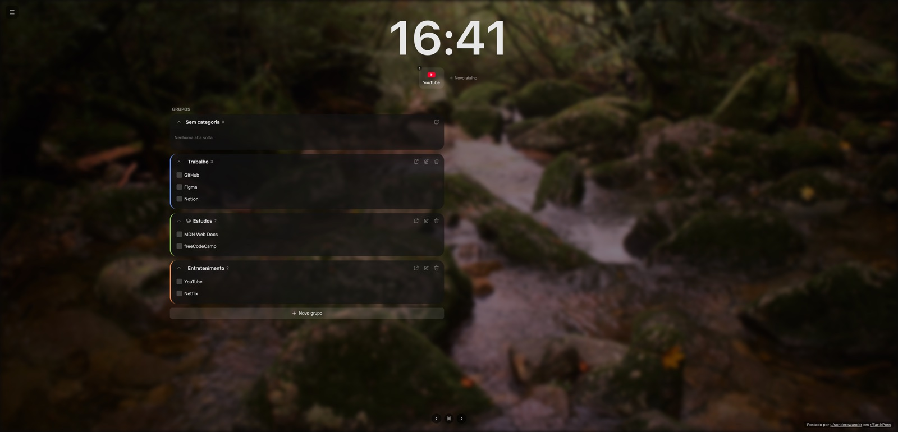
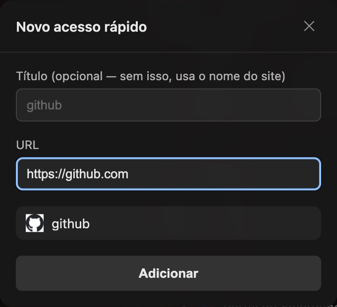

# arfyin

Extensão de Chrome pessoal que substitui a **New Tab** nativa por um gestor de abas/favoritos com visual "cozy", sincronização multi-dispositivo e papel de parede dinâmico — pensada para resolver, num único lugar, o que hoje é feito por quatro extensões separadas (Session Buddy, TabStack, Tab Group e Tabliss).

   

<p align="center">
  
</p>

## Por que existe

Eu usava quatro extensões ao mesmo tempo para resolver pedaços do mesmo problema: salvar/organizar abas em grupos, ver as abas realmente abertas, ter uma new tab bonita com relógio e papel de parede, e manter atalhos rápidos para os sites do dia a dia. Nenhuma fazia tudo junto, e nenhuma sincronizava do jeito que eu queria. O `arfyin` nasceu pra unificar isso num produto só, pessoal, sob meu controle total — inclusive o dado (tudo local primeiro, nuvem é só espelho).

## Destaques

**Gestão de abas e grupos**
- Grupos com nome, cor e ícone (seletor com busca ao vivo entre ~6 mil ícones via Iconify/Hugeicons), com pré-visualização idêntica ao card real antes de salvar.
- Drag-and-drop completo: reordenar abas dentro de um grupo, mover entre grupos, arrastar uma aba (ou seleção múltipla) direto da coluna de abas abertas para um grupo — com imagem de arraste customizada (sem o "vazamento" do papel de parede por trás de elementos translúcidos que o drag nativo do Chrome produz).
- Seleção múltipla de abas vivas, fechamento em lote, confirmação opcional antes de fechar/remover.

**Abas ao vivo**
- Todas as janelas e abas abertas, em tempo real, via `chrome.runtime.Port` — sem polling. Fechar, focar ou arrastar qualquer aba direto dali.
- Opção de fechar a aba original automaticamente ao salvá-la num grupo (modificador no drop).

**Acesso rápido**
- Até 9 atalhos numerados (`1`–`9` com foco, `Cmd/Ctrl+1..9` sem foco, `0` abre todos), com favicon automático e raio de borda configurável.
- Qualquer aba (viva ou salva) pode virar atalho com um clique — o ícone acende quando a URL já está fixada, mesmo que várias abas abertas compartilhem a mesma URL.

**New tab "cozy"**
- Três modos de layout: relógio e abas juntos, relógio em tela cheia (scroll nativo via CSS Scroll Snap revela as abas), ou só a gestão de abas.
- **Modo zen**: barra de espaço limpa a tela inteira, restaurando a posição de scroll exata ao sair.
- Relógio com fonte/peso/tamanho configuráveis e formato de data customizável por tokens (`dddd, D 'de' MMMM`).

**Papel de parede dinâmico**
- Fontes: cor sólida, imagem local, subreddits (múltiplos, todos entram no ciclo) ou tópicos do Unsplash — com crédito automático e link direto pro post/foto original.
- Três modos de rotação: estático (uma imagem travada), nova aba (sorteia a cada abertura) ou cíclico por tempo.
- Pré-carregamento das próximas imagens e cache local (stale-while-revalidate) — nenhuma requisição bloqueia a abertura de uma nova aba.

**Sincronização e backup**
- Login com Google (Supabase Auth), dados espelhados num Postgres (RLS por usuário) — logar numa máquina nova restaura tudo.
- 100% funcional offline: IndexedDB é a fonte da verdade local; a nuvem é só espelho, com fila de sync resiliente (erro de rede fica na fila, erro de dado é pulado sem travar o resto).
- Export/import de um backup único (dados + configuração) em JSON.

## Stack técnica

| Camada | Escolha |
|---|---|
| Extensão | Chrome Manifest V3 |
| Linguagem | TypeScript |
| UI | Svelte 5 (runes), sem framework de CSS |
| Bundler | Vite + `@crxjs/vite-plugin` |
| Armazenamento local | IndexedDB (via [`idb`](https://github.com/jakearchibald/idb)) |
| Sync em nuvem | [Supabase](https://supabase.com) (Postgres + Auth + Row Level Security) |
| Testes unitários | Vitest + `fake-indexeddb` |
| Testes e2e | Playwright (extensão carregada de verdade) |

### Por que essa stack

- **Svelte 5** compila para JS vanilla sem runtime pesado nem virtual DOM — essencial para uma new tab que precisa abrir instantaneamente (First Contentful Paint medido em 184ms no uso real, 100% leitura local).
- **IndexedDB**, não `chrome.storage`: o limite de ~100KB do `storage.sync` inviabiliza centenas de abas salvas; IndexedDB permite índices e volume real.
- **Service worker como processo central único**: nenhuma lógica de monitoramento de abas/janelas é duplicada entre páginas — todas as new tabs são clientes "burros" que falam com o background via mensagens + uma `Port` para updates ao vivo.
- **Supabase**: Postgres real para dados relacionais (grupo → aba), Auth + RLS resolvem multi-dispositivo sem backend próprio, tier gratuito cobre uso pessoal.

Todas as decisões de arquitetura (com alternativas descartadas e o porquê) estão documentadas em [`docs/architecture/decisions.md`](docs/architecture/decisions.md).

## Mais telas

| Configurações | Editor de grupo | Novo acesso rápido | Modo zen |
|---|---|---|---|
|  |  |  |  |

## Rodando localmente

```bash
npm install
npm run dev      # build em modo watch (dist/)
```

1. Em `chrome://extensions`, ative o **Modo do desenvolvedor**.
2. **Carregar sem compactação** → selecione a pasta `dist/`.
3. Abra uma nova aba — a extensão substitui a new tab nativa.

Variáveis de ambiente (`.env`, copie de `.env.example`) são opcionais para rodar localmente: sem elas, tudo funciona exceto login/sync (Supabase) e papel de parede do Unsplash (Reddit funciona sem chave).

### Scripts

| Comando | O que faz |
|---|---|
| `npm run dev` | Build em modo watch |
| `npm run build` | Build de produção (`dist/`) |
| `npm run test` | Testes unitários (Vitest) |
| `npm run test:e2e` | Testes e2e (Playwright, builda antes de rodar) |
| `npm run typecheck` | `tsc --noEmit` |

89 testes unitários cobrindo storage, roteamento de mensagens, fila de sync, formatação e as funções puras de UI (resolução de tecla de atalho, extração de candidatos de papel de parede, etc.).

## Estrutura do projeto

```
src/
  background/   # service worker — processo central, única fonte de verdade em runtime
  newtab/       # app Svelte que substitui a new tab
  shared/       # tipos, storage, sync, mensageria — usado por background e newtab
supabase/
  migrations/   # schema do Postgres (grupos, abas, config), versionado
docs/
  architecture/ # decisões técnicas (ADRs)
  research/     # análise das extensões concorrentes que motivaram o projeto
sdd/            # um design doc por feature, escrito antes de implementar
tests/          # unitários (Vitest) + e2e (Playwright)
```

## Como este projeto foi construído

Isso aqui é também um experimento de **desenvolvimento assistido por IA de ponta a ponta**: o código, os testes, as decisões de arquitetura e a documentação foram produzidos quase inteiramente em sessões com o [Claude Code](https://claude.com/claude-code), com validação real no Chrome a cada rodada (não só testes automatizados) e revisão humana no final de cada leva de mudanças.

O processo fica registrado no próprio repositório, não só no histórico de commits:

- [`REGISTRO.md`](REGISTRO.md) — log cronológico e detalhado de tudo que foi feito, incluindo bugs encontrados, causas raiz e o raciocínio por trás de cada correção.
- [`docs/architecture/decisions.md`](docs/architecture/decisions.md) — ADRs com as alternativas descartadas e o porquê de cada escolha de stack.
- [`sdd/`](sdd/) — um design doc por feature, escrito antes da implementação começar.
- [`kanban.md`](kanban.md) e [`feature_ideas.md`](feature_ideas.md) — rastreabilidade de card a requisito original.

## Roadmap

Os itens ainda em aberto vivem no [`kanban.md`](kanban.md) (coluna **Backlog**) — hoje, principalmente refinamentos de persistência de sessão (v2) e um keep-alive externo contra a pausa por inatividade do Supabase (deliberadamente adiado: só vira prioridade se a pausa virar um problema recorrente na prática).

## Licença

[MIT](LICENSE) — use, copie, modifique à vontade.
