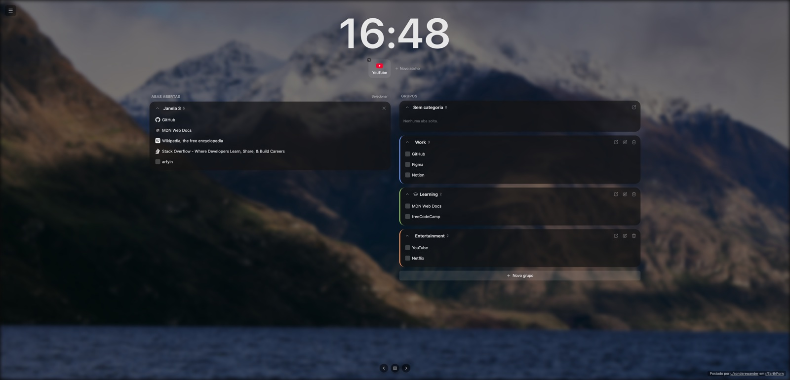
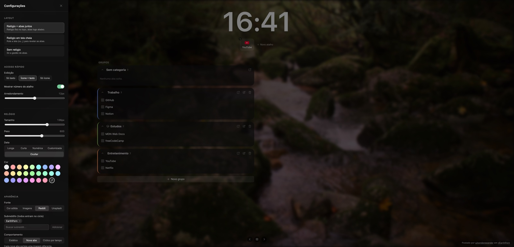
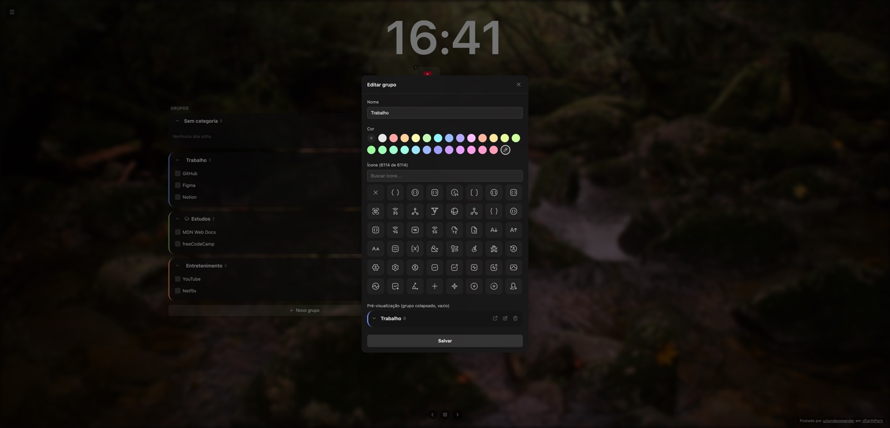

# arfyin

A personal Chrome extension that replaces the native **New Tab** page with a cozy tab/bookmark manager, multi-device sync, and a dynamic wallpaper — built to replace four separate extensions (Session Buddy, TabStack, Tab Group, and Tabliss) with one tool.

   



## Why this exists

I was running four extensions at once to cover pieces of the same problem: saving/organizing tabs into groups, seeing which tabs were actually open, having a nice-looking new tab with a clock and wallpaper, and keeping quick shortcuts to everyday sites. None of them did all of it, and none synced the way I wanted. `arfyin` unifies all of that into one personal product, fully under my control — including the data itself (local-first, the cloud is just a mirror).

## Highlights

**Tab and group management**
- Groups with a name, color, and icon (live-searchable picker across ~6,000 icons via Iconify/Hugeicons), with a preview identical to the real card before saving.
- Full drag-and-drop: reorder tabs within a group, move tabs between groups, drag a tab (or a multi-selection) straight from the open-tabs column into a group — with a custom drag image, so the wallpaper never "bleeds through" translucent elements the way Chrome's native drag snapshot does.
- Multi-select on live tabs, batch close, optional confirmation before closing/removing.

**Live tabs**
- Every open window and tab, in real time, via a `chrome.runtime.Port` — no polling. Close, focus, or drag any tab straight from there.
- Option to automatically close the original tab once it's saved into a group (a modifier key on drop).

**Quick access**
- Up to 9 numbered shortcuts (`1`–`9` while focused, `Cmd/Ctrl+1..9` unfocused, `0` opens all of them), with automatic favicons and a configurable corner radius.
- Any tab (live or saved) can become a shortcut with one click — the icon lights up when its URL is already pinned, even if several open tabs share that same URL.

**Cozy new tab**
- Three layout modes: clock and tabs together, full-screen clock (native CSS Scroll Snap reveals the tabs below), or tabs only.
- **Zen mode**: hitting spacebar clears the whole screen, restoring the exact scroll position on exit.
- Clock with configurable font, weight, and size, plus a token-based custom date format (`dddd, MMMM D`).

**Dynamic wallpaper**
- Sources: solid color, local image, subreddits (multiple, all entering the rotation), or Unsplash topics — with automatic credit and a direct link to the original post/photo.
- Three rotation modes: static (one pinned image), new tab (reshuffled on every open), or time-based cycling.
- Preloads upcoming images and caches them locally (stale-while-revalidate) — no request ever blocks opening a new tab.

**Sync and backup**
- Google sign-in (Supabase Auth), data mirrored to Postgres (per-user RLS) — logging in on a new machine restores everything.
- Fully functional offline: IndexedDB is the local source of truth; the cloud is just a mirror, backed by a resilient sync queue (network errors stay queued, data errors are skipped without blocking the rest).
- Export/import of a single backup file (data + settings) as JSON.

## Tech stack

| Layer | Choice |
|---|---|
| Extension | Chrome Manifest V3 |
| Language | TypeScript |
| UI | Svelte 5 (runes), no CSS framework |
| Bundler | Vite + `@crxjs/vite-plugin` |
| Local storage | IndexedDB (via [`idb`](https://github.com/jakearchibald/idb)) |
| Cloud sync | [Supabase](https://supabase.com) (Postgres + Auth + Row Level Security) |
| Unit tests | Vitest + `fake-indexeddb` |
| E2E tests | Playwright (loads the real built extension) |

### Why this stack

- **Svelte 5** compiles to plain JS with no heavy runtime or virtual DOM — essential for a new tab page that needs to open instantly (First Contentful Paint measured at 184ms in real usage, 100% local reads).
- **IndexedDB, not `chrome.storage`**: `storage.sync`'s ~100KB limit makes hundreds of saved tabs unworkable; IndexedDB supports indexes and real data volume.
- **A single service worker as the central process**: no tab/window-monitoring logic is ever duplicated across pages — every new tab is a "dumb" client that talks to the background via messages plus a `Port` for live updates.
- **Supabase**: real Postgres for relational data (group → tab), Auth + RLS solve multi-device sync without a custom backend, and the free tier comfortably covers personal use.

Every architecture decision (with the alternatives considered and why) is documented in [`docs/architecture/decisions.md`](docs/architecture/decisions.md).

## More screens






## Running locally

```bash
npm install
npm run dev      # watch-mode build (dist/)
```

1. In `chrome://extensions`, enable **Developer mode**.
2. **Load unpacked** → select the `dist/` folder.
3. Open a new tab — the extension replaces Chrome's native new tab page.

Environment variables (`.env`, copy from `.env.example`) are optional for local use: without them, everything works except Google login/sync (Supabase) and Unsplash wallpapers (Reddit works without a key).

### Scripts

| Command | What it does |
|---|---|
| `npm run dev` | Watch-mode build |
| `npm run build` | Production build (`dist/`) |
| `npm run test` | Unit tests (Vitest) |
| `npm run test:e2e` | E2E tests (Playwright, builds first) |
| `npm run typecheck` | `tsc --noEmit` |

89 unit tests cover storage, message routing, the sync queue, formatting, and pure UI logic (shortcut-key resolution, wallpaper candidate extraction, etc.).

## Project structure

```
src/
  background/   # service worker — central process, single source of truth at runtime
  newtab/       # Svelte app that replaces the new tab page
  shared/       # types, storage, sync, messaging — used by both background and newtab
supabase/
  migrations/   # versioned Postgres schema (groups, tabs, config)
docs/
  architecture/ # technical decisions (ADRs)
  research/     # analysis of the competing extensions that motivated this project
sdd/            # one design doc per feature, written before implementation
tests/          # unit (Vitest) + e2e (Playwright)
```

## How this project was built

This is also an end-to-end **AI-assisted development** experiment: the code, tests, architecture decisions, and documentation were produced almost entirely through sessions with [Claude Code](https://claude.com/claude-code), validated live in Chrome on every round (not just automated tests), with human review at the end of each batch of changes.

The process is tracked in the repository itself, not just in the commit history (these are written in Portuguese, my working language for this project):

- [`REGISTRO.md`](REGISTRO.md) — a detailed, chronological log of everything done, including bugs found, root causes, and the reasoning behind each fix.
- [`docs/architecture/decisions.md`](docs/architecture/decisions.md) — ADRs with the alternatives considered and the reasoning behind each stack choice.
- [`sdd/`](sdd/) — one design doc per feature, written before implementation started.
- [`kanban.md`](kanban.md) and [`feature_ideas.md`](feature_ideas.md) — traceability from each card back to the original requirement.

## Roadmap

Open items live in [`kanban.md`](kanban.md) (**Backlog** column) — currently, mostly v2 session-persistence refinements and an external keep-alive against Supabase's inactivity pause (deliberately deferred: it only becomes a priority if the pause turns into a recurring real-world problem).

## License

[MIT](LICENSE) — use, copy, and modify freely.
